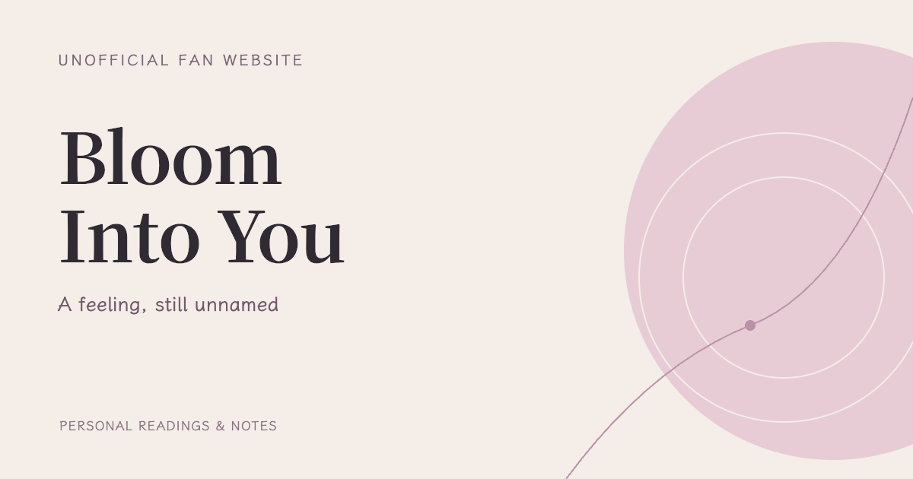

[English](README.md) | [简体中文](README.zh-CN.md)

# 终将成为你 · Bloom Into You 🌸

> 有些心绪，不知从何而起。

一个非官方、非商业的《终将成为你》（やがて君になる）粉丝网站，为故事结束之后仍留在心里的那些瞬间而做。提供英文、简体中文、繁体中文和日文四种语言。

内容涉及漫画全篇，包含结局剧透。

**[进入网站 →](https://jack11111eee.github.io/bloom-into-you/)**

## 关于原作

《终将成为你》是仲谷鳰的漫画作品，由 KADOKAWA 出版，全八卷（2015–2019），2018 年由 TROYCA 改编为 TV 动画。

## 权利与致谢

- 本站是非官方粉丝网站，与原作者、出版方及动画制作方无关，也未获得官方授权或背书。
- 漫画、动画截图、插画及角色的权利归各自权利人所有。TV 动画：©2018 仲谷 鳰／ＫＡＤＯＫＡＷＡ／やがて君になる製作委員会。
- 权利人如对任何素材有疑问，可查看[版权声明](https://jack11111eee.github.io/bloom-into-you/zh-cn/copyright/)，或写信至 [jackkkkk1e@proton.me](mailto:jackkkkk1e@proton.me)。
- 站主原创的随笔与评论正文按 [CC BY-NC-ND 4.0](https://creativecommons.org/licenses/by-nc-nd/4.0/) 提供，范围见 [LICENSING.md](LICENSING.md)。图片、引文、设计、代码和字体不在该许可之内，本仓库也没有整体授权。
- 字体、程序库及其许可见 [THIRD_PARTY_NOTICES.md](THIRD_PARTY_NOTICES.md)。网站不加载任何追踪器或第三方资源，详见[隐私说明](https://jack11111eee.github.io/bloom-into-you/zh-cn/privacy/)。

网站构建与检查的维护说明见 [CLAUDE.md](CLAUDE.md)。
